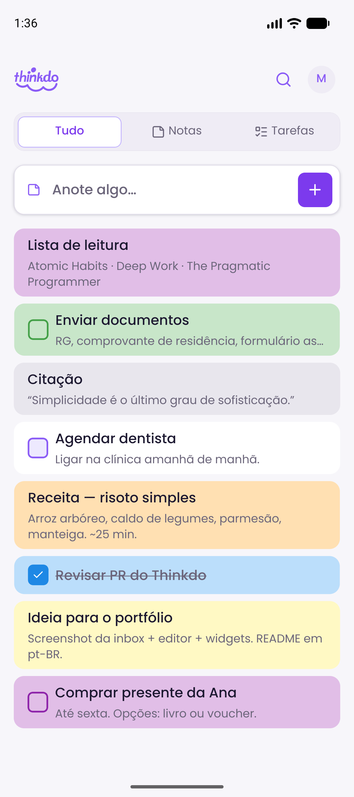
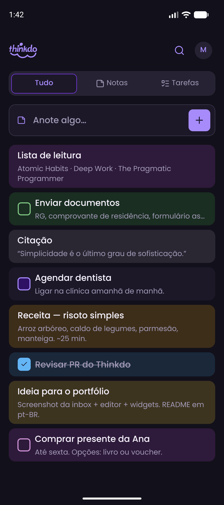
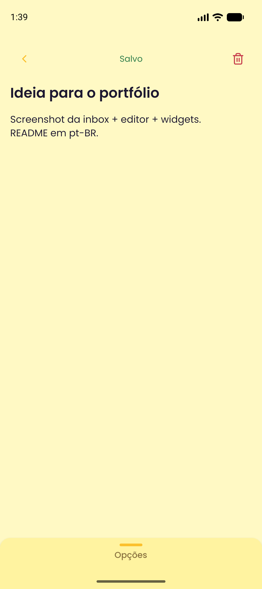
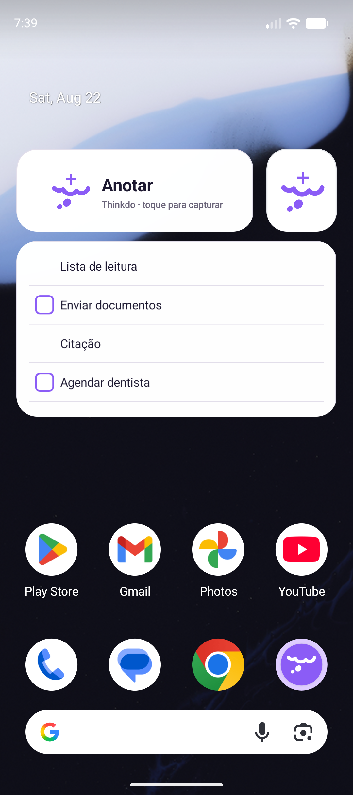

<div align="center">
  
</div>

<br />

**Suas ideias e tarefas, no mesmo lugar.**

Anote uma ideia antes que ela escape, organize suas pendências e receba lembretes na hora certa. Com o Thinkdo, você transforma notas em tarefas, encontra suas anotações pela busca e captura algo direto da tela inicial do Android.

Feito para o dia a dia, com interface em **português**, temas claro e escuro e sincronização na nuvem.

<table>
  <tr>
    <td align="center" width="25%">
      
      <br /><sub>Notas e tarefas</sub>
    </td>
    <td align="center" width="25%">
      
      <br /><sub>Tema escuro</sub>
    </td>
    <td align="center" width="25%">
      
      <br /><sub>Suas anotações</sub>
    </td>
    <td align="center" width="25%">
      
      <br /><sub>Widgets Android</sub>
    </td>
  </tr>
</table>

---

## O que você pode fazer com o Thinkdo

- **Capture rápido:** crie notas e tarefas sem sair da lista. Uma ideia pode virar uma tarefa, e vice-versa, com um toque.
- **Lembre na hora certa:** configure um lembrete para uma data específica ou repita todos os dias ou em dias da semana escolhidos.
- **Organize do seu jeito:** escolha cores, arraste os itens para mudar a ordem e filtre por notas ou tarefas.
- **Encontre o que precisa:** busque pelo título ou pelo conteúdo das suas anotações.
- **Edite sem se preocupar em salvar:** suas alterações são salvas automaticamente enquanto você escreve.
- **Mantenha tudo sincronizado:** entre com Google ou email e senha para acessar as notas e tarefas da sua conta.
- **Escolha seu tema:** use o modo claro, escuro ou acompanhe a preferência do aparelho.

### Anote direto da tela inicial

Os widgets Android deixam a captura e a consulta à mão:

- **Thinkdo Anotar:** abra a captura de uma nota ou tarefa com um toque, sem procurar o app.
- **Thinkdo Inbox:** acompanhe sua lista pela tela inicial, com atualização quando os dados mudam no app.

### Para aquelas pequenas coisas do dia

Uma ideia para depois, a lista de compras, algo para estudar ou uma tarefa que você precisa lembrar: registre tudo no mesmo lugar e organize quando quiser.

## Como experimentar

O Thinkdo é um projeto pessoal em uso diário, com foco em **Android**. Este repositório ainda não oferece um link público de instalação. Para executar sua própria versão, siga o [guia de desenvolvimento local](#desenvolvimento-local).

O app usa uma conta para sincronizar os dados. Sem conexão, a escrita fica pausada e o app exibe um aviso; a edição offline ainda não faz parte do escopo atual. Os lembretes são agendados no aparelho em que você usa o app. Concluir uma tarefa pausa seus lembretes sem apagar a configuração; reabrir retoma os próximos horários válidos, sem disparar lembretes únicos vencidos.


### Recuperação de alterações no editor

Antes de enviar alterações à nuvem, o editor guarda um rascunho local separado por conta e item. Se o envio falhar ao voltar ou colocar o app em segundo plano, o texto permanece neste aparelho. Ao reabrir, escolha **Recuperar** ou **Descartar**; nenhuma alteração recuperada é enviada antes dessa escolha. Se os mesmos campos mudaram na nuvem, o app avisa que recuperar substituirá seus valores atuais.

O indicador **Salvo** confirma o envio à nuvem; **Rascunho neste aparelho** indica alterações locais. Falhas no armazenamento local têm aviso próprio. Rascunhos são preservados ao sair da conta e reaparecem somente no login da mesma conta. Se o item foi excluído, o texto recuperável fica disponível para selecionar e copiar, sem recriar o item.

O título aceita até 500 posições e o corpo até 100.000, conforme as regras atuais do banco (unidades UTF-16; alguns emojis ocupam duas posições). Texto acima do limite é preservado no rascunho, sem truncamento, e precisa ser corrigido para enviar. Ao sair de um título vazio, o último título válido é restaurado com um aviso.

A edição continua bloqueada sem internet. Rascunhos não substituem backup: desinstalar ou limpar os dados do app os remove, e encerrar o processo antes da gravação local terminar pode perder as últimas alterações.

---

## Decisões técnicas

- **Expo SDK 57 + development build** — Google Sign-In nativo, widgets Android e notificações locais; exigem um development build
- **Organização por responsabilidade** — telas e navegação em `app/`, autenticação e lembretes em `src/features/` com componentes, serviços e testes próprios; UI compartilhada em `src/components/`, persistência de itens em `src/services/` e widgets isolados em `src/widgets/`
- **Firestore em tempo real** — `onSnapshot` na inbox; rules com validação de shape (tipo, cor, lembrete, timestamps) e isolamento por usuário
- **Lembretes locais** — intenção persistida no Firestore, alarme agendado no aparelho via `expo-notifications`; reconciliação ao abrir o app
- **Widgets com snapshot** — lista espelhada em storage local para render offline no widget; refresh após mutações
- **Design system** — tokens de cor, tipografia (Poppins) e espaçamento; light/dark consistentes entre app e widgets
- **Testes unitários** — helpers de item, auth, lembretes, busca/seleção na inbox e lógica de widgets

---

## Stack

| Camada | Tecnologia |
|--------|------------|
| App | Expo 57 · Expo Router · React Native 0.86 · React 19 |
| UI | Reanimated · Gesture Handler · Lucide |
| Backend | Firebase Auth · Cloud Firestore |
| Nativo | Google Sign-In · expo-notifications · react-native-android-widget |
| Qualidade | TypeScript · Jest · ESLint |

---

## Estrutura (visão geral)

```
app/          → rotas, telas e navegação
src/
  components/ → UI compartilhada, inbox, editor, itens e settings
  features/
    auth/     → autenticação, sessão, componentes, paleta e tipos
    reminders/ → lembretes, edição, notificações, navegação e tipos
  services/   → persistência e exclusão de itens no Firestore
  widgets/    → configuração, render, links, atualização e snapshot Android
  hooks/      → estado e coordenação de inbox, seleção e editor
  lib/        → tema, conteúdo/ordenação de itens e inicialização do Firebase
  types/      → tipos compartilhados de itens e declaração de SVG
  screens/    → testes de integração de telas
  test/       → utilitários compartilhados de teste
firebase/     → rules, indexes e testes no emulador
```

---

## Status

- **Uso:** app pessoal, Android-first
- **Escopo atual:** captura, inbox, editor, lembretes, widgets, tema — sem labels, prazos, edição offline ou rich text
- **Licença:** [MIT](LICENSE)

---

## Desenvolvimento local

### Pré-requisitos

- Node.js **22.13+**, conforme a [documentação do Expo SDK 57](https://docs.expo.dev/versions/v57.0.0/), e npm.
- Android Studio com Android SDK, JDK e variáveis de ambiente configurados para compilar apps Android.
- Emulador com Google Play Services ou aparelho Android com Google Play Services e depuração USB habilitada.
- Projeto Firebase próprio com Authentication e Cloud Firestore.

O app precisa de um **development build** por usar Google Sign-In nativo, widgets e notificações. O Expo Go não executa todos esses módulos.

### 1. Instalar dependências e configurar o ambiente

Na raiz do projeto:

```sh
npm ci
```

Copie o arquivo de exemplo:

**Linux/macOS**

```sh
cp .env.example .env
```

**Windows (PowerShell)**

```powershell
Copy-Item .env.example .env
```

Preencha todas as variáveis do `.env`. Os valores `EXPO_PUBLIC_FIREBASE_*` vêm da configuração de um **app Web** registrado no seu projeto Firebase; o app usa o SDK JavaScript do Firebase. O valor `EXPO_PUBLIC_GOOGLE_WEB_CLIENT_ID` é o ID OAuth do tipo **Aplicativo da Web**, configurado no próximo passo.

### 2. Configurar Firebase e Google Sign-In

No [console do Firebase](https://console.firebase.google.com/):

1. Registre um app Web e copie sua configuração para as variáveis `EXPO_PUBLIC_FIREBASE_*`.
2. Em **Authentication → Sign-in method**, habilite **Email/Password** e **Google**. Configure também o email de suporte do provedor Google.
3. Crie o **Cloud Firestore** e escolha a região do banco. Publique as regras deste projeto antes de usar o app, conforme o próximo passo.
4. Registre um app Android com o package definido em `expo.android.package`, no `app.json` — atualmente `com.justmate.thinkdo`.
5. Adicione os fingerprints **SHA-1 e SHA-256** do certificado que assina cada build usado: debug local e, se aplicável, builds EAS e assinatura do Google Play. Confira se existe um cliente OAuth Android com o mesmo package e SHA-1 no projeto Google Cloud associado.
6. No Google Cloud associado ao Firebase, confira o cliente OAuth do tipo **Aplicativo da Web** e copie seu ID para `EXPO_PUBLIC_GOOGLE_WEB_CLIENT_ID`. Esse valor é passado como `webClientId` em `src/features/auth/authService.ts`. Se a tela de consentimento estiver em modo de teste, inclua as contas que usarão o login entre os usuários de teste.

Após gerar o projeto Android pela primeira vez, você pode consultar os certificados locais com `./gradlew signingReport`, dentro de `android/` (no PowerShell, `./gradlew.bat signingReport`). Para builds distribuídos, use os fingerprints dos respectivos certificados de assinatura.

Consulte a [configuração do Google Sign-In](https://react-native-google-signin.github.io/docs/setting-up/get-config-file) e o [guia para Expo](https://react-native-google-signin.github.io/docs/setting-up/expo) para detalhes sobre OAuth e configuração nativa. A configuração atual usa Firebase via JavaScript e informa o ID web explicitamente; o `app.json` não declara `googleServicesFile`.

Para usar builds EAS em uma cópia própria, ajuste também `owner` e `extra.eas.projectId` no `app.json` para a sua conta e seu projeto Expo.

### 3. Publicar regras e índices do Firestore

Autentique a CLI e execute o deploy **de dentro da pasta `firebase/`**, onde está o `firebase.json`. Substitua `SEU_PROJECT_ID` pelo mesmo projeto configurado no `.env`.

```sh
npx firebase-tools login
cd firebase
npx firebase-tools deploy --only firestore --project SEU_PROJECT_ID
cd ..
```

Esse comando publica as regras e os índices definidos em `firebase/firestore.rules` e `firebase/firestore.indexes.json`. O projeto de destino fica explícito, conforme as opções da [CLI do Firebase](https://firebase.google.com/docs/cli).

### 4. Compilar e executar no Android

Com o emulador aberto ou aparelho conectado, execute na raiz:

```sh
npm run android
```

O comando compila e instala o development build e inicia o servidor de desenvolvimento. Nas próximas sessões, com o build já instalado:

```sh
npx expo start --dev-client
```

Recompile após mudanças em dependências nativas ou plugins do `app.json`. Para testar os widgets, adicione **Thinkdo Anotar** e **Thinkdo Inbox** pela tela inicial do Android. Para testar lembretes, permita notificações quando solicitado pelo app.

### Validação

Execute na raiz:

```sh
npm test -- --runInBand
npm run lint
npx tsc --noEmit
```

Os testes Jest ficam junto dos módulos em `__tests__/`. Os testes de regras em `firebase/tests/` usam o emulador do Firestore e são executados separadamente; exigem Java compatível com o emulador:

```sh
npx firebase-tools emulators:exec --config firebase/emulator.json --project demo-thinkdo --only firestore "node --test firebase/tests/firestore.rules.test.mjs"
```

Imports internos usam `@/` para `src/` e `@/assets/` para `assets/`.
